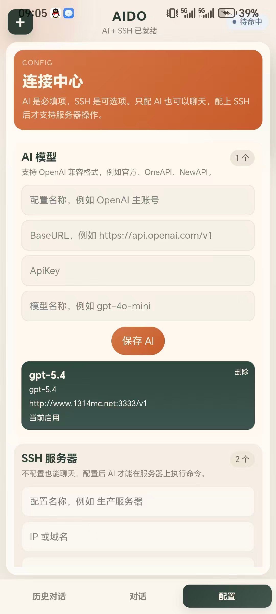
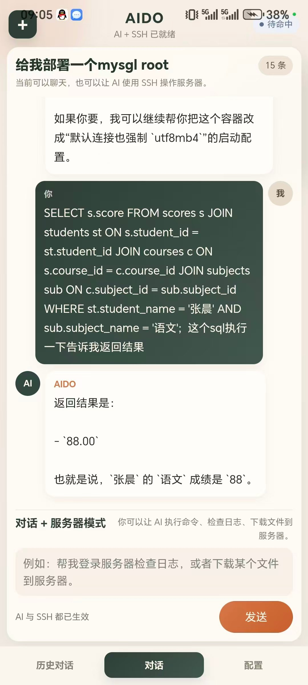
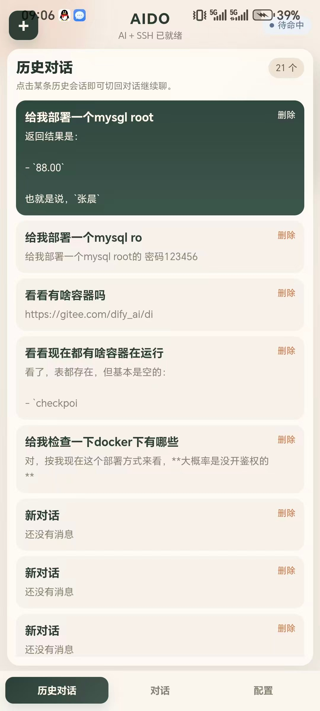

# AIDO · 安卓端 AI 远程运维助手

**用自然语言下指令，让 AI 直接在手机端 SSH 上去把命令跑掉。**

AIDO 是一个 `uni-app` 安卓 App：手机里存好 SSH 连接信息和一份 OpenAI 兼容的模型配置，然后在聊天框里说人话——"看看现在都有哪些容器在跑"、"执行一下这条 SQL 告诉我结果"——AI 通过工具调用 `ssh_exec`，把命令真正发到你的云服务器上执行，把结果带回对话里。

<p align="center">
  
  
  
</p>

<p align="center"><sub>左：连接中心（AI 模型 + SSH 服务器配置）｜中：自然语言下指令，AI 执行后回传结果｜右：本地历史会话</sub></p>

## 为什么做这个

在手机上排查服务器，通常得装个 SSH 客户端，然后在软键盘上敲命令、翻日志，很难受。AIDO 换了个思路：把"敲命令"变成"说需求"，AI 负责把它翻译成命令、执行、再把输出解释成人话。手机端因此只需要一个对话框。

## 功能

- **SSH 配置本地保存**：IP / 端口 / 用户名 / 密码，支持存多台
- **AI 配置本地保存**：BaseURL / ApiKey / model，兼容 OpenAI `chat/completions` 格式（官方、OneAPI、NewAPI 等聚合网关都能接）
- **自然语言操控服务器**：AI 通过工具调用 `ssh_exec` 在服务器上执行命令，结果回填到对话
- **流式输出**：回复逐字渲染，长回答不用干等
- **本地会话历史**：新建 / 切换 / 删除，重启 App 不丢
- **内置 UTS SSH 插件**：Android 端由 UTS 插件调用 JSch 完成真正的 SSH 连接，不依赖外部 SSH 客户端
- **提示词里带了安全约束**：`utils/prompt.js` 明确要求模型不主动执行 `rm -rf`、`reboot`、`shutdown`、`passwd`、`userdel` 这类危险命令

## 技术栈

| 分类 | 选型 |
| --- | --- |
| 框架 | uni-app + Vue 3 + Vite |
| 原生能力 | UTS 原生插件（`uni_modules/aido-ssh`），Android 端用 JSch 执行 SSH |
| 模型接入 | OpenAI 兼容 `chat/completions`，SSE 流式解析（`utils/sse.js`） |
| Agent | 本地编排（`services/agent.js`）：多轮对话 + `ssh_exec` 工具调用循环 |
| 存储 | 本地 storage（`utils/storage.js`）保存 SSH / AI 配置与会话 |
| 打包 | HBuilderX（已产出 Android 包，`unpackage/dist` 下有 app-plus 产物） |

## 目录结构

```
aido-uniapp-android/
├─ pages/index/index.vue       聊天主界面：会话列表、消息展示、发送、流式渲染
├─ pages/settings/index.vue    连接中心：管理 AI 与 SSH 配置
├─ services/agent.js           本地 Agent 编排：AI 回复、工具调用、多轮对话
├─ services/openai.js          OpenAI 兼容接口流式请求
├─ services/nativeSsh.js       前端到 UTS SSH 插件的调用封装
├─ utils/prompt.js             系统提示词（含危险命令约束）
├─ utils/sse.js                SSE 流式解析
├─ utils/storage.js            本地配置与会话持久化
├─ components/                 SectionCard / StatusPill 等 UI 组件
└─ uni_modules/aido-ssh        UTS SSH 插件（app-android 下接 JSch）
```

## 运行

```bash
npm install
npm run dev:h5      # 先看 UI 和本地配置逻辑
```

真正要跑 SSH 和稳定流式，建议按安卓 App 方式跑：

1. 用 HBuilderX 导入本项目目录
2. 首次运行 Android 时，HBuilderX 会按 UTS 配置解析 Android 依赖
3. 真机或模拟器运行

## 已知限制

- 密码和 ApiKey 目前是**本地明文存储**，先把流程跑通优先；生产化需要接 KeyStore / 加密存储
- 目前只支持**密码登录 SSH**，还没做私钥登录
- 会话历史只在本地，没有后端同步
- 工具只提供 `ssh_exec`，文件上传/下载还没做
- 不同 OpenAI 兼容网关的流式格式有细微差异，接第三方聚合网关时可能需要按实际返回微调 `services/openai.js`

## 后续可以做的

- 执行中的长命令支持取消
- 敏感命令二次确认弹窗
- 常用命令模板（看磁盘、看日志、下载文件）
- 扩展 `upload_file` / `download_file` / `read_file` 等工具
- 会话重命名与搜索
